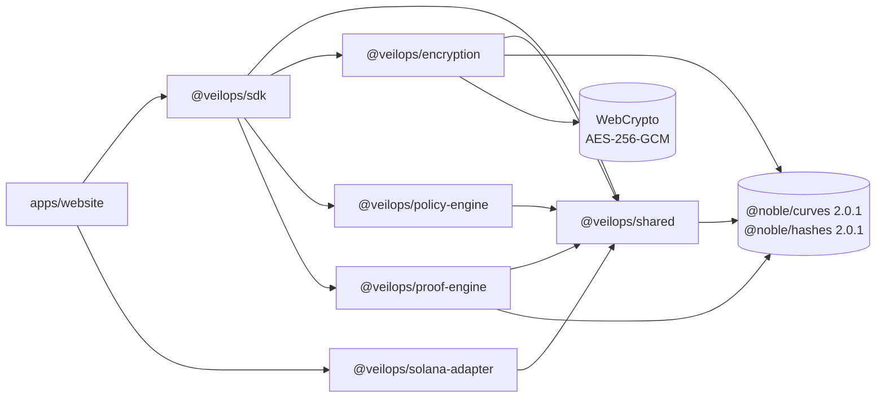
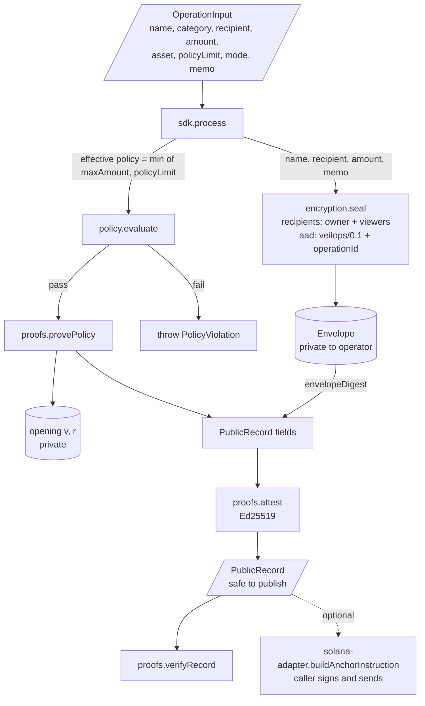
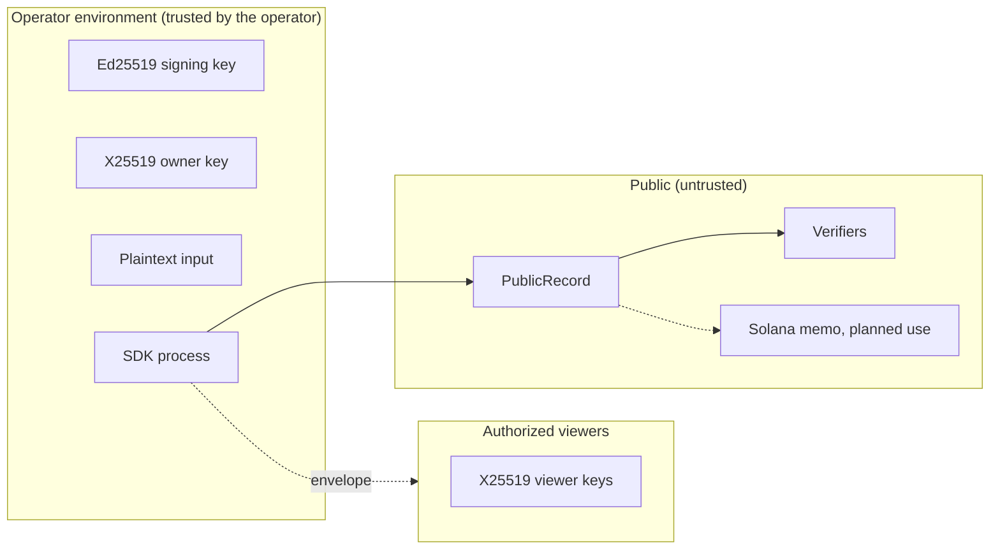

# Architecture

Status: Phase 01 (Foundation). Everything described here exists in this repository unless it is explicitly marked **planned**.

## Design principles

1. **Local first.** Every package runs in the browser and in Node. The SDK makes no network calls and never persists keys.
2. **Publish proofs, not data.** The only artifact meant for publication is a `PublicRecord`, which contains commitments, digests, a proof and a signature, never a plaintext amount.
3. **Disclosure is explicit.** Plaintext lives in an encrypted envelope, readable only by keys the operator chose. Amounts can additionally be disclosed by handing out the commitment opening.
4. **Verification is a pure function.** `verifyRecord(record)` needs nothing but the record.
5. **Honest status labels.** Each component is `implemented`, `experimental`, `simulated` or `planned` (`ImplementationStatus` in `@veilops/shared`).

## Package graph

| Package | Depends on | Responsibility |
| --- | --- | --- |
| `@veilops/shared` | `@noble/hashes` | `PublicRecord` / `OperationInput` types, `canonicalJson`, `contentId`, `randomId`, base64/hex helpers, `PROTOCOL_VERSION = 'veilops/0.1'` |
| `@veilops/encryption` | shared, `@noble/curves`, `@noble/hashes`, WebCrypto | `seal`, `open`, `openText`, `grantAccess`, `envelopeDigest`, `generateViewingKeyPair` |
| `@veilops/policy-engine` | shared | `definePolicy`, `validatePolicy`, `evaluate`, `evaluatePublic`, `policyId` |
| `@veilops/proof-engine` | shared, `@noble/curves`, `@noble/hashes` | Pedersen commitments, `proveRange`/`verifyRange`, `provePolicy`/`verifyPolicy`, `attest`/`verifyAttestation`, `verifyRecord` |
| `@veilops/sdk` | all of the above | `createClient` with `process()`; re-exports `shared` and namespaces `encryption`, `policy`, `proofs` |
| `@veilops/solana-adapter` | shared | `anchorMemo`, `buildAnchorInstruction`, `parseAnchorMemo`, `recordDigest` |

## Data flow

Notes on the flow as implemented:

- The envelope is sealed **before** the policy is evaluated, so a rejected operation still costs one encryption; the envelope is simply discarded.
- The effective limit is `min(policy.maxAmount, input.policyLimit)`. The published `policy.maxAmount` and `policy.id` describe this effective policy, not the policy object passed in.
- The SDK verifies its own output (`verified` stage) before returning, using the same `verifyRecord` that third parties use.

## Trust boundaries

- Everything inside the operator environment is trusted by the operator; VEILOPS does not protect against a compromised operator machine.
- Verifiers trust only mathematics plus the operator's public signing key. The range proof is sound without trusting the operator; the attestation tells them who published the record.
- Viewers are trusted with the plaintext of the envelopes they were granted.

See [security.md](security.md) for the full threat model.

## Solana integration (current and planned)

| Component | Status |
| --- | --- |
| SPL Memo anchor instruction (`veilops:<version>:<proofId>:<sha256(record)>`) | Experimental: built and parsed; never sent by the package; not exercised on devnet, testnet or mainnet (`CLUSTER_STATUS` marks all three `untested`) |
| Token-2022 confidential transfer integration | Planned |
| On-chain program (registry / verification) | Planned; no program exists in this repository |

## Website

`apps/website` is a Next.js 16 (App Router, Tailwind, Framer Motion) site for veilops.tech. It consumes the packages as workspaces and displays a sample explorer dataset generated by `scripts/generate-samples.ts`; every record in that dataset is flagged `sample: true`.
