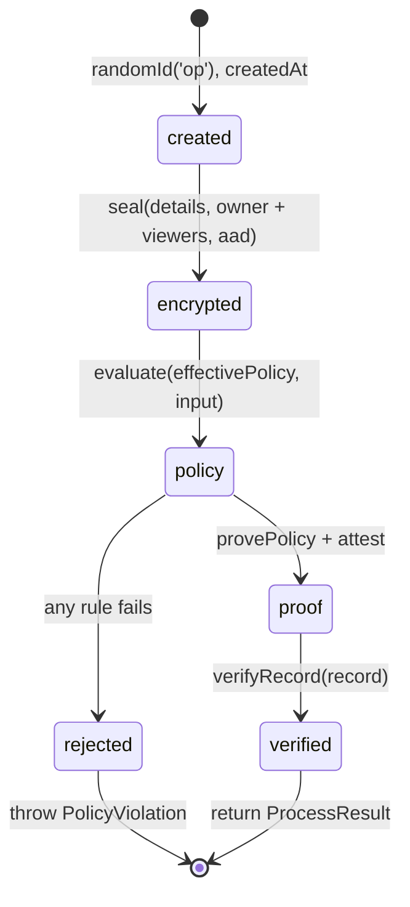

# Protocol

Protocol version: `veilops/0.1` (`PROTOCOL_VERSION` in `@veilops/shared`). Proof system: `veilops-range-v1`. Status: experimental; the format may change before any release.

## Objects

### `OperationInput` (private, never published)

| Field | Type | Meaning |
| --- | --- | --- |
| `name` | string | Human label, e.g. "October contributor payout" |
| `category` | `'treasury' \| 'payroll' \| 'vendor' \| 'grant' \| 'operations'` | Operation category |
| `recipient` | string | Recipient identifier (address, handle, pseudonym) |
| `amount` | integer | Amount in the asset's smallest display unit (e.g. cents); non-negative safe integer |
| `asset` | string | Asset ticker, e.g. `USDC` |
| `policyLimit` | integer | Per-operation limit; the effective limit is `min(policy.maxAmount, policyLimit)` |
| `mode` | `'amount-only' \| 'amount-and-recipient' \| 'full'` | Confidentiality mode |
| `memo` | string, optional | Free text, encrypted only |

### `Policy`

| Field | Default (`definePolicy`) | Meaning |
| --- | --- | --- |
| `name` | required | Label |
| `maxAmount` | required | Non-negative safe integer, `< 2^rangeBits` |
| `allowedCategories` | all five categories | Public rule |
| `allowedAssets` | `USDC, SOL, USDT, PYUSD` | Public rule |
| `minimumMode` | `amount-only` | Public rule; ranking `amount-only < amount-and-recipient < full` |
| `rangeBits` | `32` | Bits covered by each range proof, `1..48` (`MAX_RANGE_BITS`) |

`policyId(policy)` = `pol_` + first 16 hex chars of `SHA-256(canonicalJson(policy))`.

### `Envelope` (private, held by the operator and viewers)

```ts
{
  alg: 'AES-256-GCM+X25519-HKDF-SHA256',
  aad: 'veilops/0.1|<operationId>',
  nonce: '<12-byte hex>',
  ciphertext: '<base64>',               // JSON {name, recipient, amount, memo}
  keys: [{ recipient, ephemeral, nonce, wrapped }]  // one wrap per authorized X25519 key
}
```

### `PublicRecord` (published)

| Field | Example / format | Meaning |
| --- | --- | --- |
| `version` | `veilops/0.1` | Protocol version |
| `operationId` | `op_` + 16 hex | Random operation id |
| `proofId` | `prf_` + 20 hex | `SHA-256(canonicalJson(proof))`, truncated; binds the id to the proof |
| `createdAt` | ISO-8601 | Time the operation was created (operator clock, not verified) |
| `category` | `payroll` | Public |
| `asset` | `USDC` | Public |
| `mode` | `amount-and-recipient` | Public |
| `policy` | `{ id, maxAmount, rangeBits }` | Effective policy id, limit and proof width; all public |
| `amountCommitment` | 32-byte hex | Pedersen commitment `C = v·G + r·H` on ristretto255 |
| `envelopeDigest` | 32-byte hex | `SHA-256(ciphertext \| nonce \| aad)`; identifies the envelope without revealing it. Key wraps are not covered, so `grantAccess` does not change it |
| `recipient` | string, optional | Present **only** in `amount-only` mode |
| `proofSystem` | `veilops-range-v1` | Proof system identifier |
| `proof` | base64 | `base64(JSON(PolicyProof))` |
| `attestation` | `{ publicKey, signature }` | Ed25519 public key and signature, hex |
| `sample` | boolean, optional | Set on demo/sample records only |

`PolicyProof` = `{ system: 'veilops-range-v1', lower: RangeProof, upper: RangeProof }`, where `RangeProof = { n, bits: BitProof[] }` and `BitProof = { C, c0, c1, s0, s1 }` (point and scalars as hex). See [cryptography.md](cryptography.md).

### Confidentiality modes as implemented

| Mode | Amount in record | Recipient in record |
| --- | --- | --- |
| `amount-only` | commitment only | **plaintext** |
| `amount-and-recipient` | commitment only | omitted |
| `full` | commitment only | omitted |

In Phase 01, `full` produces the same record shape as `amount-and-recipient`; it differs only in satisfying a stricter `minimumMode`. Category, asset and timestamps are public in every mode.

## Lifecycle

`createClient(opts).process(input, policy, { onStage })` runs five stages and emits a `StageEvent { stage, at, ms, detail, ok }` after each one.



| Stage | What happens | Output |
| --- | --- | --- |
| `created` | Random operation id `op_…` and timestamp | `operationId`, `createdAt` |
| `encrypted` | Payload `{name, recipient, amount, memo}` sealed with AES-256-GCM; data key wrapped for the owner and each viewer | `envelope` |
| `policy` | Five rules evaluated on plaintext: `category.allowed`, `asset.allowed`, `mode.minimum` (public) and `amount.integer`, `amount.withinLimit` (confidential). Failure throws `PolicyViolation` and no proof is produced | `policy` result |
| `proof` | Commitment and two range proofs generated; record assembled and signed with Ed25519 | `record`, `opening` |
| `verified` | The SDK runs `verifyRecord` on its own output | `verification` |

`ProcessResult` = `{ operationId, record, envelope, policy, verification, opening, stages }`. Only `record` is meant to be published.

## Verification algorithm

`verifyRecord(record)` (in `@veilops/proof-engine`) returns a report with these checks, in order:

1. `system`: decoded proof has `system === 'veilops-range-v1'`.
2. `bits`: both range proofs have `n === policy.rangeBits`.
3. `limit`: `maxAmount` is a safe integer with `0 ≤ maxAmount < 2^rangeBits`.
4. `commitment`: `amountCommitment` decodes to a valid ristretto255 point.
5. `lower`: the range proof on `C` verifies (`0 ≤ v < 2^n`).
6. `upper`: the range proof on `D = maxAmount·G − C` verifies (`0 ≤ maxAmount − v < 2^n`).
7. `proofId`: `proofIdOf(proof) === record.proofId`.
8. `attestation`: the Ed25519 signature over `"VEILOPS/record/v1|" + canonicalJson(record without attestation)` verifies under `attestation.publicKey`.

The record is valid only if all checks pass. The Fiat–Shamir context binds the proof to `operationId`, `policyId`, `maxAmount`, `rangeBits`, `asset`, `category` and `amountCommitment`; the remaining fields (`createdAt`, `mode`, `recipient`, `envelopeDigest`, …) are bound by the signature.

What a verifier does **not** check, because it cannot:

- that `policy.id` corresponds to a particular full policy (allowed categories, assets, minimum mode are not published, so the id cannot be recomputed from the record alone);
- that `createdAt` is accurate;
- that the signing key belongs to a particular organization (key distribution is out of scope in Phase 01);
- that the envelope contents match the commitment (an auditor can check this with the opening).

## Selective disclosure

1. **Envelope access**: the operator includes viewer keys at `createClient({ viewers })`, or later calls `grantAccess(envelope, ownerSecret, viewerPublicKey)`, which adds a key wrap without re-encrypting the payload.
2. **Amount disclosure**: the operator gives `opening = { value, blinding }` to a party, who checks `verifyOpening(record.amountCommitment, BigInt(value), scalarFromHex(blinding))`.

Disclosure cannot be revoked: once a party has the plaintext or the opening, they have it.

## Anchoring (experimental)

`@veilops/solana-adapter` encodes `veilops:<version>:<proofId>:<sha256(canonicalJson(record))>` as an SPL Memo instruction (`MemoSq4gqABAXKb96qnH8TysNcWxMyWCqXgDLGmfcHr`). The package never signs or sends; the memo format has not been exercised on any Solana cluster.
