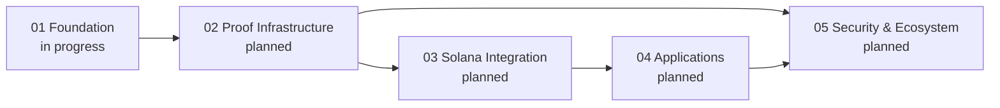

# Roadmap

There are no dates on this roadmap. Phases are ordered by dependency; items move only when code and tests exist.

Legend: **Done** (in this repository, tested) · **In progress** · **Planned** (design or intent only).

## Phase 01: Foundation (in progress)

| Item | Status |
| --- | --- |
| npm-workspaces monorepo, shared types, canonical JSON | Done |
| `@veilops/encryption`: AES-256-GCM envelopes, X25519 + HKDF-SHA256 wraps, `grantAccess` | Done (unit-tested, not reviewed) |
| `@veilops/policy-engine`: public + confidential rules | Done |
| `@veilops/proof-engine`: `veilops-range-v1` Pedersen + bit-decomposition range proofs | Done (experimental, not audited) |
| Ed25519 attestation of public records | Done |
| `@veilops/sdk`: five-stage `process()` lifecycle | Done |
| `@veilops/solana-adapter`: SPL Memo anchor builder/parser | Done as experimental code; untested on any cluster |
| Test suite (74 tests: unit, integration, security, reference vectors) | Done |
| Reference test vectors + independent Python verifier | Done |
| Reproducible package builds + signed build provenance | Done |
| Documentation, CI, community files | Done |
| Website (veilops.tech) with sample explorer | In progress |
| Public GitHub organization `veilops-protocol` and repositories | Done (2026-11-20) |

## Phase 02: Proof Infrastructure (planned)

- Versioned, compact binary proof encoding (derive `c_1`, drop hex/JSON/base64 layering).
- Batch verification of bit proofs (multi-scalar multiplication).
- Evaluate a logarithmic-size range proof (for example Bulletproofs) as `veilops-range-v2`.
- Written security argument for the composed `veilops-range-v1` statement.
- Benchmarks published with the hardware and method used.

## Phase 03: Solana Integration (planned)

- Exercise the memo anchor on devnet; document results before claiming support.
- Token-2022 confidential transfer integration for settlement.
- Design (and only then implement) an on-chain program for record registration or verification. No program exists today.
- Wallet-adapter examples for signing and sending anchor transactions.

## Phase 04: Applications (planned)

- Explorer that verifies records client-side.
- Reference treasury and payroll flows.
- Auditor workflow: request access, receive `grantAccess`, verify openings.
- Key management guidance (operator key storage, viewer key rotation).

## Phase 05: Security & Ecosystem (planned)

- External cryptography review and security audit; results published in full.
- Published npm packages with provenance and versioned releases.
- Bug bounty, if and when funding exists (none today).
- Integrations and third-party SDK bindings.
